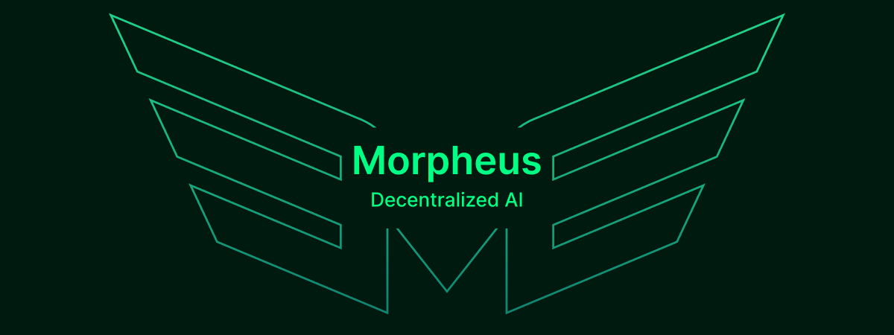

  
  
An open, decentralized network for AI inference.

  
  
  
  
  
  
  
  

## How to contribute

Start in [Discussions](https://github.com/orgs/MorpheusAIs/discussions). Open an issue, then fork or branch from `dev` and open a PR into `dev`. Maintainers promote `dev → test → main`. See [CONTRIBUTING.md](https://github.com/MorpheusAIs/.github/blob/main/CONTRIBUTING.md).

## Security

Report security issues privately. See [SECURITY.md](https://github.com/MorpheusAIs/.github/blob/main/SECURITY.md).
